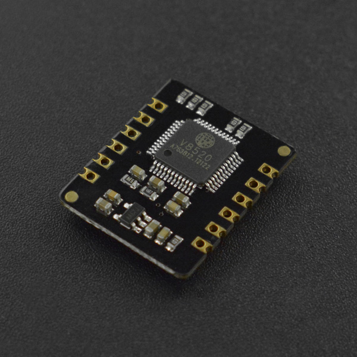

# DFRobot_BloodOxygen_S

- [中文版](./README_CN.md)

The DFRobot MAX30102 heart rate and oximeter sensor integrates the Maxim MAX30102 chip and an MCU with heart rate and oximetry algorithm, which can help output heart rate and oximeter values directly. The MAX30102 uses PPG(PhotoPlethysmoGraphy) to measure data, which will be converted into heart rate and oximetry values when processed by the MCU, then output through I2C or UART, making the sensor easy to use and greatly reducing resource occupation of main controller. Meanwhile, the corresponding upper computer is provided to allow you to conveniently read data by a PC.



## Product Link（[https://www.dfrobot.com/product-2164.html](https://www.dfrobot.com/product-2164.html)）

  SKU：SEN0344

## Table of Contents

* [Installation](#installation)
* [Methods](#methods)
* [Compatibility](#compatibility)
* [History](#history)
* [Credits](#credits)

## Summary
This library provides sample codes to get the current heart rate and oxygen saturation of users. examples/gainHeartbeatSPO2 runs directly on earlier products. examples/getSignalInfo demonstrates the new APIs and is for hardware versions above V2.0. Hardware V2.0 is not supported.

## Installation

To use this library, first download the library file, paste it into the \Arduino\libraries directory, then open the examples folder and run the demo in the folder.

## Methods
```C++
   /**
    * @struct sHeartbeatSPO2
    * @brief The struct for storing heart rate and oxygen saturation
    */
   typedef struct
   {
     int SPO2;
     int Heartbeat;
   } sHeartbeatSPO2;
   /**
    * @struct sSignalInfo
    * @brief Status and signal quality from hardware above V2.0
    * @n Hardware V2.0 is not supported. The fields are valid only after getSignalInfo returns true.
    * @n perfusion is the perfusion index in units of 0.01%. A value of 100 means 1.00%.
    * @n SQI is the signal quality, 0 to 100.
    * @n ledLevel is the infrared LED drive level.
    */
   typedef struct
   {
     uint8_t status;
     uint8_t sequence;
     uint16_t perfusion;
     uint8_t SQI;
     uint8_t ledLevel;
   } sSignalInfo;
   /**
    * @enum ebautrate
    * @brief Baud rate enum
    */
   typedef enum
   {
     BAUT_RATE_1200 = 0,
     BAUT_RATE_2400 = 1,
     BAUT_RATE_9600 = 3,
     BAUT_RATE_19200 = 5,
     BAUT_RATE_38400 = 6,
     BAUT_RATE_57600 = 7,
     BAUT_RATE_115200 = 8
   } ebautrate; 
   DFRobot_BloodOxygen_S(void){};
   ~DFRobot_BloodOxygen_S(void){}; 
   /**
    * @fn getHeartbeatSPO2
    * @brief Get heart rate and oxygen saturation and store them into the struct sHeartbeatSPO2
    */
   void getHeartbeatSPO2(void); 
   /**
    * @fn getTemperature_C
    * @brief Get the sensor board temp
    * @return The current onboard temp (unit: ℃)
    */
   float getTemperature_C(void); 
   /**
    * @fn setBautrate
    * @brief Set serial baud rate of the sensor
    * @param bautrate baud rate
    * @n  BAUT_RATE_1200 
    * @n  BAUT_RATE_2400 
    * @n  BAUT_RATE_9600 
    * @n  BAUT_RATE_19200 
    * @n  BAUT_RATE_38400 
    * @n  BAUT_RATE_57600 
    * @n  BAUT_RATE_115200 
    */
   void setBautrate(ebautrate bautrate); 
   /**
    * @fn getBautrate
    * @brief Get serial port baud rate
    * @return Serial port baud rate
    */
   uint32_t getBautrate(void); 
   /**
    * @fn sensorStartCollect
    * @brief Data collecting starts
    */
   void sensorStartCollect(void); 
   /**
    * @fn sensorEndCollect
    * @brief Data collecting stops
    */
   void sensorEndCollect(void);
   /**
    * @fn getVersion
    * @brief Read the firmware version register
    * @n This register exists on the earlier products as well as later ones.
    * @n 0x0100 is the earlier firmware. 0x0200 is hardware V2.0.
    * @return Version word. 0 means the register could not be read.
    */
   uint16_t getVersion(void);
   /**
    * @fn getSignalInfo
    * @brief Read measurement status, sequence, PI, signal quality and infrared LED level
    * @n This API can be used on hardware versions above V2.0.
    * @n Hardware V2.0 is not supported, and neither are earlier products.
    * @n Check the return value before using _sSignalInfo. A status of 0 is a real stopped state only when this function returns true.
    * @return true when the connected hardware is above V2.0 and the data has been stored in _sSignalInfo
    * @return false on hardware V2.0, earlier products, or a failed read. _sSignalInfo is cleared.
    */
   bool getSignalInfo(void);

```
## Compatibility

MCU                | Work Well | Work Wrong | Untested  | Remarks
------------------ | :----------: | :----------: | :---------: | -----
Arduino Uno  |      √       |             |            | 
Leonardo  |      √       |             |            | 
Meag2560 |      √       |             |            | 
M0 |      √       |             |            | 
ESP32 |      √       |             |            | 
ESP8266 |      √       |             |            | 

## History

- 2019/12/13 - 1.0.0 version
- 2026/11/05 - 1.1.0 version. Add getVersion, getSignalInfo, and examples/getSignalInfo. getSignalInfo supports hardware above V2.0 and does not support V2.0. The existing example still runs on earlier products.

## Credits

Written by Pengkaixing(kaixing.peng@dfrobot.com), 2021. (Welcome to our [website](https://www.dfrobot.com/))
